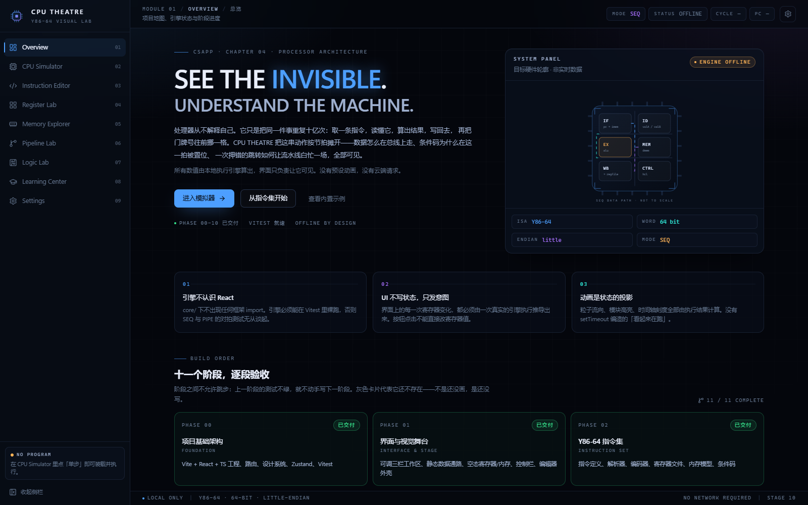
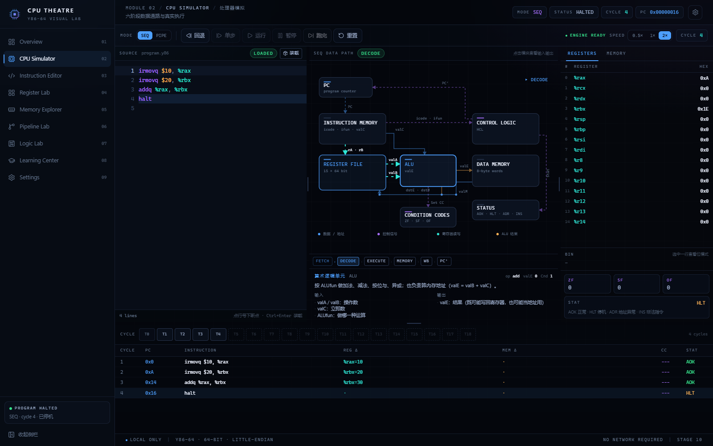
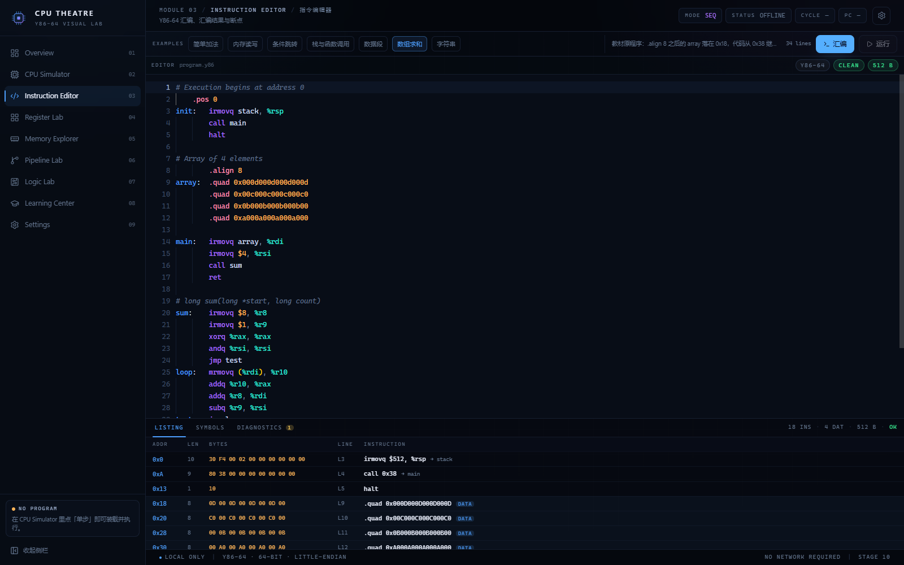
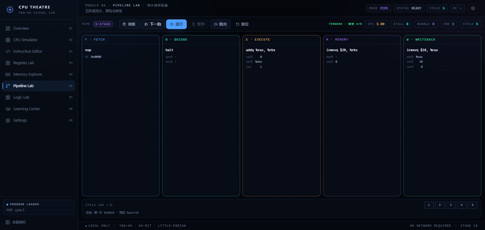

# CPU THEATRE

**[在线试玩 →](https://rainandcr.github.io/cpu-theatre/)** · 无需安装、无需账号、断网也能用
（首次进入编辑器需下载约 700 KB 的 Monaco，慢网可能等十几秒）

**SEE THE INVISIBLE. UNDERSTAND THE MACHINE.**

一个完全运行在浏览器本地的 Y86-64 处理器可视化实验室：写一段汇编，看它变成机器码，
看它逐拍穿过取指、译码、执行、访存、写回，看寄存器与内存被真实地改写。

技术依据：*Computer Systems: A Programmer's Perspective*（CSAPP）第 4 章 Processor Architecture。
代码与文案均为本项目原创实现，未复制教材正文。

## 30 秒看懂



界面支持**中文 / 英文 / 中英对照**三档语言与**深色 / 浅色**双主题：语言切换只换文字、
不动布局；双语模式用「主行 + 次级行」表达对应关系；两套主题共用一份语义令牌，
浅色下的硬件色会压暗以满足 4.5:1 的正文对比度。

九个模块共用一台真实执行的引擎。下面三张图不是设计稿——脚本会启动应用、点按钮、
等执行结束后再截图。



*内置加法示例跑完后的状态：`%rax=0xA`、`%rbx=0x1E`。执行日志、寄存器与数据通路高亮同源，
不是三套各自更新的 UI。*

| Instruction Editor | Pipeline Lab |
| --- | --- |
|  |  |
| 教材 Figure 4.7：18 条指令的地址、长度、机器码，以及 `.quad` 数据行 | 推进五拍：五级同拍、转发计数、CPI |

> 截图由 `node scripts/capture-docs.mjs` 生成（`npm run build` 后运行），可随代码更新重拍。

---

## 当前状态

**全部 11 个阶段已完成** — 可运行、可调试、可对拍的 Y86-64 模拟器。
SEQ 与 PIPE 共用同一套指令语义，两者的终态一致性有自动化测试保证；
界面上的每一个数值都来自一次真实执行。

| 模块 | 路由 | 状态 |
| --- | --- | --- |
| Overview | `/` | 可用（项目地图与阶段进度） |
| CPU Simulator | `/simulator` | 可用：六阶段执行、断点、回退、阶段动画 |
| Instruction Editor | `/editor` | 可用：汇编出真实机器码、符号表与诊断，支持 `.pos` / `.align` / `.quad` / `.string` 数据段（含教材 Figure 4.7） |
| Register Lab | `/registers` | 可用：15 个寄存器、位模式、条件码与状态码 |
| Memory Explorer | `/memory` | 可用：逐字节视图、窗口跟随 PC、访存高亮 |
| Pipeline Lab | `/pipeline` | 可用：五级流水线、转发/暂停/气泡、CPI 统计 |
| Logic Lab | `/logic` | 可用：门电路实验台、ALU 实验、HCL 片段 |
| Learning Center | `/learning` | 可用：4 个模块、13 个知识点、自测与进度 |
| Settings | `/settings` | 可用（真实生效，本地持久化） |

窄屏（<1024px）使用抽屉式导航：汉堡按钮打开、ESC 关闭、选完模块自动收起，焦点会还给触发按钮。

> 占位页面不摆放演示数据。一个教学工具最伤信任的做法，是让用户以为自己看到的是真实执行结果。

需要**双击即用**的桌面版？

```bash
npm run package:win   # 产出 release/CPU THEATRE-win32-x64/（免安装，含 Electron 运行时）
npm run smoke:packaged
```

桌面壳用自定义 `cpu://` scheme 加载 `dist/`，因此 Web 版与桌面版共用同一份产物，
不需要改 `base`。详见 [Windows 指南](docs/WINDOWS.md)。

## 它不是什么

- 不是 x86-64 模拟器：指令集严格限定在 Y86-64，不混入真实 CPU 的指令。
- 不是只有动画的展示页：界面上的每个数值都必须来自引擎的一次真实执行。
- 不是在线服务：没有账号、没有后端、没有 CDN 依赖，断网可用（`e2e/offline.spec.ts` 会拦截并断言零外部请求）。

## 快速开始（Windows）

前置：Node.js 22+，npm 10+。完整说明（含 EXE 打包方案）见 [Windows 指南](docs/WINDOWS.md)。

```bash
npm install          # 安装依赖
npm run dev          # 开发服务器 http://localhost:5173
npm run build        # 类型检查 + 生产构建，产物在 dist/
npm run preview      # 预览构建产物
npm test             # 运行 Vitest 测试
npm run test:watch   # 监听模式
npm run test:coverage # 覆盖率
npm run test:e2e      # Playwright 端到端 + 视觉回归（dev）
npm run test:e2e:prod # 同一批行为用例跑生产产物（需先 npm run build）
npm run test:e2e:update # 重建视觉基线（换机器/换浏览器大版本时）
npm run typecheck    # 仅做类型检查
npm run lint         # oxlint
```

离线说明：所有依赖（含 Monaco 编辑器）都从 `node_modules` 打包进产物，运行时不请求任何外部资源。
首次 `npm install` 需要联网，之后可完全离线开发与运行。

## 部署到 GitHub Pages

线上地址：<https://rainandcr.github.io/cpu-theatre/>。推送到 `main` 即自动发布
（`.github/workflows/pages.yml`），PR 不部署。

三件在静态托管上必须处理的事：

| 问题 | 处理 |
| --- | --- |
| 站点在 `/<repo>/` 下，资源要用绝对前缀 | 构建时读 `CPU_BASE`，默认 `/`，所以本地 dev、桌面版不受影响 |
| 深链刷新会 404（没有服务器回落） | 产物里放一份 `404.html`（内容同 `index.html`），地址栏不变，React Router 照常接管 |
| Jekyll 会忽略 `_` 开头的文件 | 产物里放 `.nojekyll` |

本地复现线上环境（模拟「子路径 + 404 回落」，`vite preview` 自带 SPA 回落，测不出这两点）：

```bash
CPU_BASE=cpu-theatre/ npm run build:pages   # 产物含 404.html 与 .nojekyll
npm run preview:pages                       # http://localhost:4183/cpu-theatre/
```

`CPU_BASE` 允许不带前导斜杠：Git Bash 会把 `/cpu-theatre/` 这类环境变量当成本机路径重写，
构建能过但线上全 404。

## 技术栈

React 19 · TypeScript 7（strict）· Vite 8 · Tailwind CSS 4 · Zustand 5 · Framer Motion · SVG · Monaco Editor · Vitest 5 · Testing Library

## 目录结构

```
src/
  core/            纯 TypeScript 引擎，禁止 import React
    cpu/           字表示、寄存器文件、内存、条件码、状态码
    isa/           指令定义、编解码、汇编解析
    execution/     六阶段纯函数：fetch / decode / execute / memory / writeback / pcUpdate
    seq/           SEQ 顺序处理器
    pipe/          PIPE 流水线处理器、流水线寄存器、冒险控制、转发
    assembler/     两遍扫描汇编器、标签解析
    debugger/      执行历史、断点
  components/      UI 组件（layout / ui / 舞台 / 面板）
  config/          导航、路线图、架构与验收用例的单一数据源
  pages/           九个模块页面
  store/           Zustand：cpu / editor / program / settings
  hooks/           媒体查询等纯 UI 钩子
  lib/             工具函数、内置示例程序
tests/             isa / assembler / cpu / seq / pipe / perf / store / ui 八类测试
docs/              架构决策、路线图、阶段报告
```

## 三条硬约束

1. **引擎不认识 React。** `src/core/**` 里出现任何框架 import，就是设计事故。
2. **UI 不写状态，只发意图。** 按钮不能直接改寄存器值；每次变化都必须由一次真实执行推导。
3. **动画是状态的投影。** 粒子、高亮、时间轴都从执行结果计算，不用 `setTimeout` 编造进度。

## 文档

- **[项目现状（先读这个）](docs/STATUS.md)** — 能做什么、验证到什么程度、还剩什么
- [架构与决策记录](docs/ARCHITECTURE.md)
- [开发路线图与验收门槛](docs/ROADMAP.md)
- [Phase 00 交付报告](docs/PHASE-0.md)
- [Phase 01 交付报告](docs/PHASE-1.md)
- [Phase 02 交付报告](docs/PHASE-2.md)
- [Phase 03–10 交付报告](docs/PHASE-10.md)
- [Y86-64 指令集参考](docs/ISA.md)
- [测试报告](docs/TEST-REPORT.md)
- [Windows 运行与打包](docs/WINDOWS.md)
